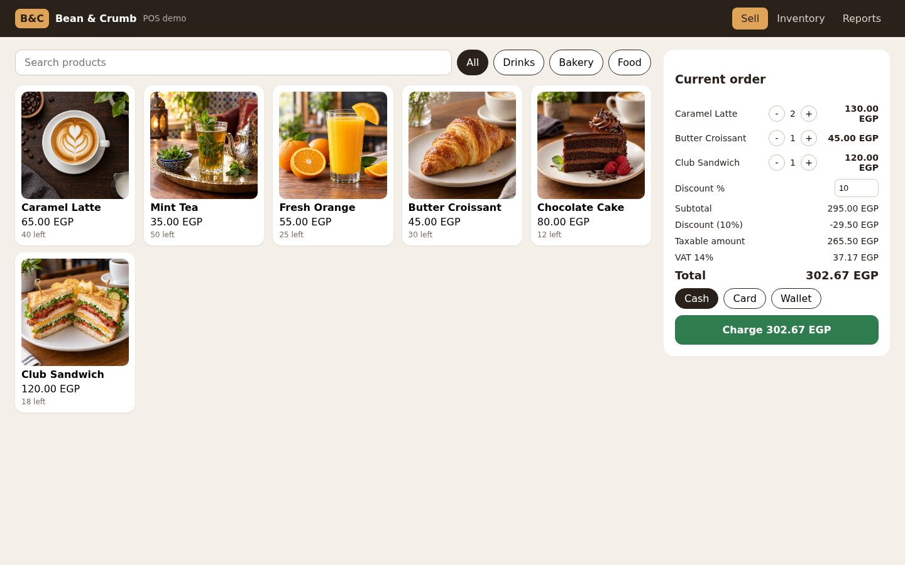
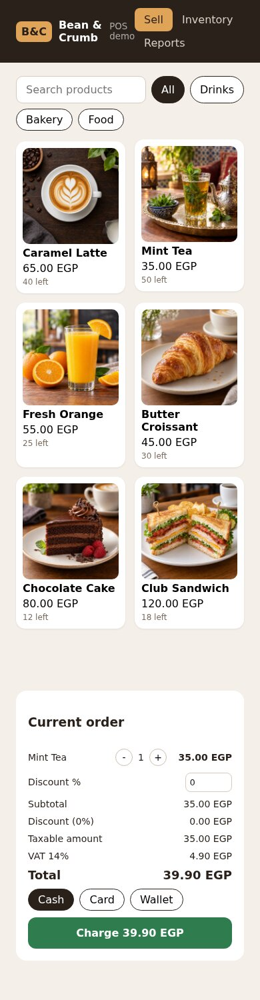
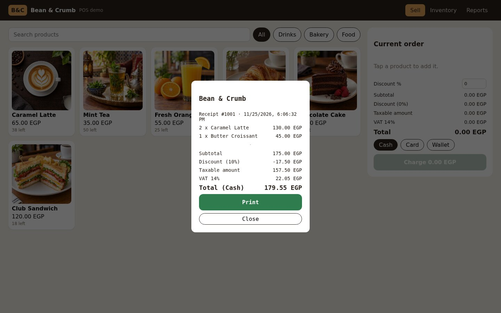

# Bean & Crumb POS (React + Vite)

A point-of-sale demo for a fictional cafe. Not a real business; product photos are AI-generated.

Features: product search and categories, cart with quantity controls, percent discount, 14% VAT, cash/card/wallet,
stock that drops on each sale and blocks overselling, receipt with print, inventory restock, daily report
(orders, revenue, average order, best sellers). Data is saved in the browser (localStorage), no backend.

## Run
    npm install
    npm run dev
    npm run build

## Demo video
[docs/demo.mp4](docs/demo.mp4) (short screen recording of the main flows)

## Preview

## How it works
- Stock is checked on every add, so a product can't be oversold
- Totals: subtotal, percent discount, then 14% VAT on the discounted amount
- Orders and stock persist in `localStorage`; "Reset demo data" restores the starting state
- Money is rounded to 2 decimals at each step (subtotal, discount, taxable amount, VAT), and the receipt shows every step
- Discount is clamped to 0-100%; quantity is capped at the stock on hand

## About the tax line
The 14% VAT is a fixed, illustrative rate for this demo. A real shop needs correct tax rules per product and a certified receipt system. This is not a production POS.
